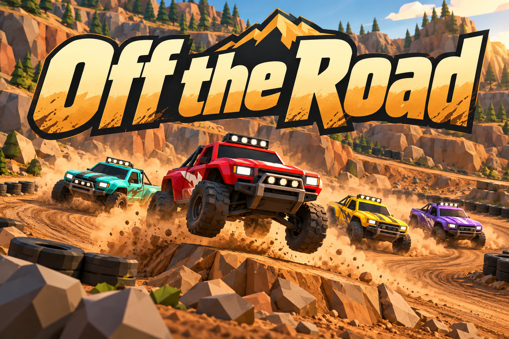

# Off the Road branding



Official name: **Off the Road**.

## Art direction

Low-poly quarry racing with copper dirt, black tire markers and four colored trucks beneath warm cream and ochre lettering.

The existing project-name/documentation/gameplay.png capture and project-name/src/view.js establish Copper Basin's low-poly quarry, colored trucks, tire markers and jumps. The screenshot was viewed for visual context only. The final image was generated from a text prompt without supplying, cropping, tracing or compositing a screenshot.

## Asset and usage

- File: `docs/images/game-logo.png`.
- Purpose: README splash illustration and game-directory thumbnail.
- Generation: built-in OpenAI image generation through the existing Codex session. No API key, separately billed API or external image service was used.
- Format: opaque PNG, 1536 by 1024 pixels.
- Keep the complete title visible when displaying or resizing the image. The official name excludes "Multiplayer"; multiplayer capability remains documented separately where applicable.

## Final generation prompt

```text
Use case: logo-brand. Create a completely original landscape 3:2 arcade racing splash illustration from scratch. Exact and only text "Off the Road", with those exact words and capitalization. Giant bold warm cream and ochre custom motorsport lettering fills the upper half, clearly readable at 240px width, strong dark outlines. Underneath, four small original chunky off-road pickup racing trucks in red, turquoise, yellow and violet slide around a dusty copper-brown quarry hairpin, with black tire markers, angular boulders and a small tabletop jump. Front truck red, tires lifted as it hits the jump, dust sweeping across the bottom without covering the title. Style: polished low-poly 3D toy-diorama illustration, hard angular geometry, warm ochre sand and copper dirt, deep charcoal-green shadows, restrained warm sunlight. Inspired by the actual game's fixed-camera Blender-built Copper Basin quarry circuit and four colored trucks. New promotional camera/composition; no screenshot, no HUD, no game screen, no copied track map, no manufacturer logos, no watermark, no other text and never Multiplayer. Generous safe margins and opaque background.
```
